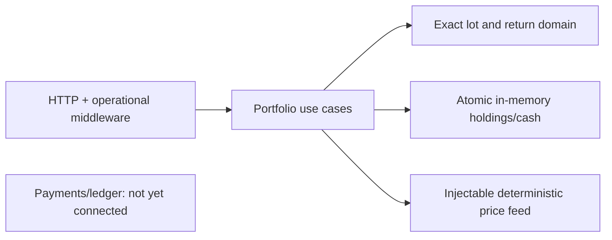

# Portfolio Tracker (CQRS)

Synthetic investment accounting in Go: FIFO/average-cost domain lots, realized/unrealized P&L, deterministic price marks and local cash. No real money or credentials.

## Run and verify

```sh
GOTOOLCHAIN=local HTTP_ADDR=127.0.0.1:8105 CASH_MODE=local go run ./cmd/server
curl --fail http://127.0.0.1:8105/readyz
GOTOOLCHAIN=local go test -p 2 ./... -race -count=1 -cover
```

Configuration: `HTTP_ADDR` defaults to `:8105`; `CASH_MODE` supports only `local`; `COST_METHOD` supports `FIFO` (default) and `AVERAGE_COST`. Unsupported `PAYMENTS_URL` or `DATABASE_URL` fails startup rather than silently simulating external funding. State is lost on restart. `/healthz`, `/readyz` and `/metrics` report local-memory initialization and per-process request/error/panic counters, not external dependency readiness.



Production trade routes share one accounting store. `POST /v1/portfolios/{id}/trades` accepts `symbol`, `side` (BUY/SELL), decimal-string `quantity` and `price`, explicit `currency` (USD/EUR/GBP/JPY), plus `Idempotency-Key` or body `idempotency_key`. Same-payload replay is 201; changed payload is 409. Position trades use `/positions/{symbol}/trades`. Both reject missing keys and oversells. Buys atomically debit local cash and sells credit it; insufficient funds return 409. Fund the local simulation with `/cash/fund` first. Settlement rejects fractional minor units rather than rounding; see [ADR 0001](docs/adr/0001-exact-local-settlement.md).

`GET /v1/portfolios/{id}/summary?currency=USD&as_of=100&max_age=0` and `/positions/{symbol}` use explicit Unix-second cutoff and maximum price age. Register instruments with `POST /v1/instruments` and inject simulated historical marks with `POST /v1/prices`; lookup routes are `/v1/instruments/{symbol}` and `/v1/prices/{symbol}?currency=USD&as_of=100&max_age=0`. These writes use the same header/body key rules. Symbols are case-sensitive path-safe ASCII identifiers up to32 characters; denomination and each symbol/currency/timestamp mark are immutable. Out-of-order mark publication is supported; all valuation queries select the latest mark at/before cutoff, never a future mark. The Go price-feed port remains injectable. Holdings are the current snapshot: `as_of` chooses historical price marks only, not historical holdings/trade replay. No FX conversion or cross-currency aggregation is implemented. Missing/stale marks fail rather than inventing zero values. Summary `TotalValue` is securities only, not cash-inclusive NAV. See [`api/openapi.yaml`](api/openapi.yaml).

Corporate actions use keyed `POST /v1/portfolios/{id}/corporate-actions`: `symbol`, `currency` and `kind` (`SPLIT`, `DIVIDEND`, `FEE`). SPLIT takes positive integer `numerator`/`denominator`; DIVIDEND/FEE take a positive total cash `amount`, not a per-share rate. Shares/basis, cash and original replay response commit atomically. Splits/dividends require held shares; fees may charge a previously held closed position but cannot overdraw cash. Unsupported repeating split shares are rejected; no cash-in-lieu. Split actions do not rewrite price history: publish an appropriate post-action simulated mark explicitly. Corporate keys have their own global namespace. See [ADR 0003](docs/adr/0003-corporate-actions.md).

Portfolio mutations now append atomic UTC/sequence-ordered command and holdings/cash snapshots in memory. Only FUND/WITHDRAW are external investor flows (contributions negative, withdrawals positive); trades/dividends/fees/splits are internal investment effects. Clock regression or invalid time returns503 before effect/key/history changes; already successful replays remain available. Repository history pages and historical snapshot lookup are implemented and tested. Historical NAV is now exposed below; raw history and return-rate HTTP routes remain unimplemented. Full-snapshot memory grows with commands times holdings/lot size and is lost on restart; see [ADR 0004](docs/adr/0004-local-command-history.md).

`GET /v1/portfolios/{id}/valuation?currency=USD&as_of=<unix-seconds>&max_age=<seconds>` reconstructs historical cash plus securities NAV, not current holdings. The cutoff is the exact START of the Unix second: a command at110s+750ns is excluded by110 and included by111. Response `as_of` is canonical UTC date-time. Closed positions retain realized PnL with zero market value and `price_as_of:null`; cash-only books need no marks. Missing snapshots return404; missing/stale/future marks or unsupported FX return400. The default command clock is actual UTC wall time, independent of the synthetic price timestamp100 in the example. See [ADR0005](docs/adr/0005-historical-nav.md).

## Local synthetic example

With the server running, publish a mark, fund local cash, buy two units and value them:

```sh
base=http://127.0.0.1:8105/v1
id=9113183e-08e9-455b-bfc8-a522c352bd20
curl --fail -H 'Content-Type: application/json' -H 'Idempotency-Key: instrument-acme' "$base/instruments" -d '{"symbol":"ACME","currency":"USD"}'
curl --fail -H 'Content-Type: application/json' -H 'Idempotency-Key: mark-acme-100' "$base/prices" -d '{"symbol":"ACME","currency":"USD","amount":"10","as_of":100}'
curl --fail -H 'Content-Type: application/json' -H 'Idempotency-Key: local-fund' "$base/portfolios/$id/cash/fund" -d '{"currency":"USD","amount":"50"}'
curl --fail -H 'Content-Type: application/json' -H 'Idempotency-Key: local-buy' "$base/portfolios/$id/trades" -d '{"symbol":"ACME","currency":"USD","side":"BUY","quantity":"2","price":"5"}'
curl --fail "$base/portfolios/$id/summary?currency=USD&as_of=100&max_age=0"
```

This is local simulation, not funding through payments or ledger. Any nonzero portfolio UUID currently selects local state; no portfolio lifecycle API is implemented yet.

## Measured status

On 2026-10-18, macOS arm64, Go 1.27.1: build/vet/race gates passed; domain package coverage **95.7%**. Aggregate non-cmd coverage with `go test -p 2 ./... -race -count=1 -coverpkg=./... -coverprofile=coverage.out` is **92.64% (994/1073 unique statements)**, including cross-package handler/repository execution from preserved playback. Default package-local instrumentation reports **84.62% (908/1073)**; it does not instrument dependencies used by other packages' tests. Actual server-router regression: `TestRuntimeRouterSharesTradePositionAndMarkedSummary`. The original in-process 1,000-request playback still passes against the legacy adapter; it does not prove the production router or a real-process 10,000-request target.

Operational middleware uses UUID request IDs and JSON errors, structured logs without bodies/keys, 16 KiB strict JSON mutation bodies and panic recovery. Server read-header/read/write/idle timeouts are 5/10/15/60 seconds; SIGTERM drains requests for up to five seconds then forces closure. Tests: `TestOperationalRequestsRecoveryReadinessAndMetrics`, `TestStrictBoundedBodiesAndUniformErrors`, `TestServeCancellationDrainsActiveRequest` and `TestServeErrorsAndForcedShutdown`. A native process smoke on port8105 verified health/readiness/metrics and clean SIGTERM exit on 2026-10-18; it is not an integrated S3 test.

Incomplete: portfolio lifecycle, TWR/MWR return queries and returns HTTP, payment-backed funding/outbox, Postgres parity, CI and complete production documentation. Historical NAV is proved by `TestHistoricalNAVUsesEarlierHoldingsAndCashAfterFullSale` and `TestHistoricalNAVHTTPExactCutoffClosedHoldingsAndNoFutureLeakage`. Local history/clock proofs are `TestTimestampedCommandHistoryFlowsSnapshotsAndIsolation`, `TestConcurrentHistorySnapshotsAreOrderedAndAtomic` and `TestHistoryClockHTTPUnavailableHasNoEffectAndSameKeyCanRetry`. Corporate-action worked/concurrent proofs are `TestCorporateWorkedDividendFeeAndSplit`, `TestCorporateHTTPConcurrentReplayCashAndWorkedValuation` and `TestConcurrentCorporateFeesCannotOverdrawAndFailureDoesNotConsumeKey`. Existing trade clients still auto-register denominations on their first successful trade; explicit registration cannot change those denominations. Management replay/concurrency and historical selection are proved by `TestInstrumentAndPriceReplayImmutableHistoryAndConcurrency` and `TestMarketHTTPManagementAndHistoricalPortfolioValuation`. Repeating average-cost/split residuals are preserved by authoritative lot basis and exact final allocation; [ADR 0002](docs/adr/0002-authoritative-lot-basis.md) states the fixed allocation precision and unsupported fractional-share split policy. Local cash is an in-memory simulation; no durable recovery or integrated S3 claim is made.
