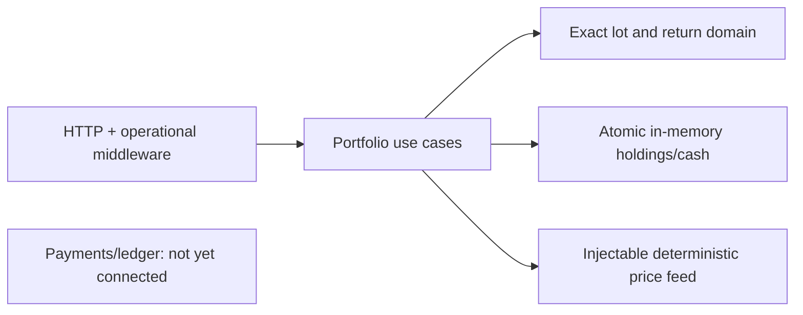

# Portfolio Tracker (CQRS)

Synthetic investment accounting in Go: FIFO/average-cost domain lots, realized/unrealized P&L, deterministic price marks and local cash. No real money or credentials.

## Run and verify

```sh
GOTOOLCHAIN=local HTTP_ADDR=127.0.0.1:8105 CASH_MODE=local go run ./cmd/server
curl --fail http://127.0.0.1:8105/readyz
GOTOOLCHAIN=local go test -p 2 ./... -race -count=1 -cover
```

Configuration: `HTTP_ADDR` defaults to `:8105`; `CASH_MODE` supports only `local`; `COST_METHOD` supports `FIFO` (default) and `AVERAGE_COST`. Unsupported `PAYMENTS_URL` or `DATABASE_URL` fails startup rather than silently simulating external funding. State is lost on restart. `/healthz`, `/readyz` and `/metrics` report local-memory initialization and per-process request/error/panic counters, not external dependency readiness.



Production trade routes share one accounting store. `POST /v1/portfolios/{id}/trades` accepts `symbol`, `side` (BUY/SELL), decimal-string `quantity` and `price`, explicit `currency` (USD/EUR/GBP/JPY), plus `Idempotency-Key` or body `idempotency_key`. Same-payload replay is 201; changed payload is 409. Position trades use `/positions/{symbol}/trades`. Both reject missing keys and oversells. Buys atomically debit local cash and sells credit it; insufficient funds return 409. Fund the local simulation with `/cash/fund` first. Settlement rejects fractional minor units rather than rounding; see [ADR 0001](docs/adr/0001-exact-local-settlement.md).

`GET /v1/portfolios/{id}/summary?currency=USD&as_of=100&max_age=0` and `/positions/{symbol}` use explicit Unix-second cutoff and maximum price age. Marks are injected through the Go price-feed port; the server currently has no mark-seeding route/config. Missing/stale marks fail rather than inventing zero values. Summary `TotalValue` is securities only, not cash-inclusive NAV. See [`api/openapi.yaml`](api/openapi.yaml).

## Measured status

On 2026-10-18, macOS arm64, Go 1.27.1: build/vet/race gates passed; domain package coverage **94.9%**. Aggregate non-cmd coverage with `go test -p 2 ./... -race -count=1 -coverpkg=./... -coverprofile=coverage.out` is **88.11% (630/715 unique statements)**, including cross-package handler/repository execution from preserved playback. Default package-local instrumentation reports **74.83% (535/715)**; it does not instrument dependencies used by other packages' tests. Actual server-router regression: `TestRuntimeRouterSharesTradePositionAndMarkedSummary`. The original in-process 1,000-request playback still passes against the legacy adapter; it does not prove the production router or a real-process 10,000-request target.

Operational middleware uses UUID request IDs and JSON errors, structured logs without bodies/keys, 16 KiB strict JSON mutation bodies and panic recovery. Server read-header/read/write/idle timeouts are 5/10/15/60 seconds; SIGTERM drains requests for up to five seconds then forces closure. Tests: `TestOperationalRequestsRecoveryReadinessAndMetrics`, `TestStrictBoundedBodiesAndUniformErrors`, `TestServeCancellationDrainsActiveRequest` and `TestServeErrorsAndForcedShutdown`. A native process smoke on port8105 verified health/readiness/metrics and clean SIGTERM exit on 2026-10-18; it is not an integrated S3 test.

Incomplete: instrument/price management, corporate-action/returns HTTP, payment-backed funding/outbox, Postgres parity, CI and complete production documentation. Instrument denominations currently bind on the first successful trade; no instrument registry API exists yet. Repeating average-cost/split residuals are preserved by authoritative lot basis and exact final allocation; [ADR 0002](docs/adr/0002-authoritative-lot-basis.md) states the fixed allocation precision and unsupported fractional-share split policy. Local cash is an in-memory simulation; no durable recovery or integrated S3 claim is made.
